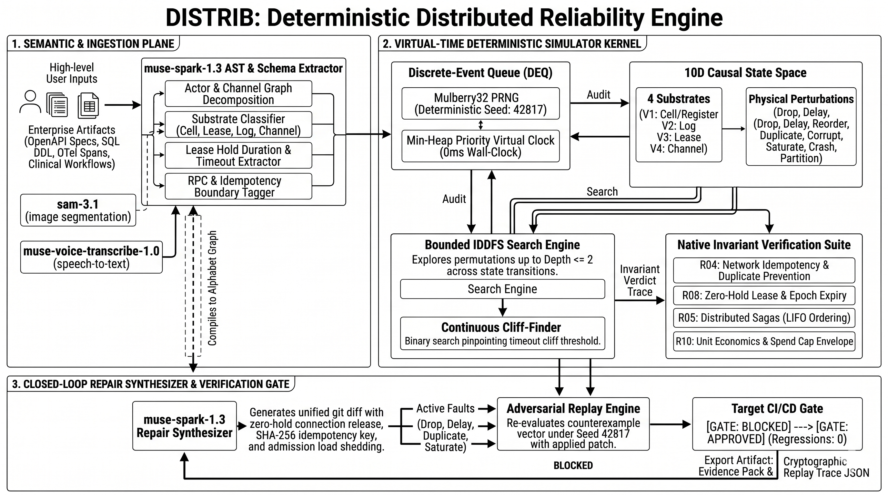

<div align="center">
  
  <h1>DISTRIB</h1>
  <p><strong>Deterministic Distributed Reliability & Invariant Verification Engine for AI-Powered Infrastructure</strong></p>
</div>

---

# enterprise-simulator

Standalone deterministic simulator for a refund workflow, M6 enterprise queue/worker/resource scenarios, M7 Enterprise Chaos Lab, and M8 LLM Agent Context Lab. All infrastructure is simulated.

**Everything is simulated.** The virtual clock, mock services, and in-memory SQLite do not measure real infrastructure. The app, demo, and default tests need no credentials, paid APIs, or cloud services. Dependency installation may contact the npm registry; after installation, the simulator itself makes no external network requests. Server tests verify that test traffic stays on loopback.

## 🛑 Disclosure: Pre-Existing Work vs. Hackathon Build

To comply with hackathon integrity rules, we are explicitly documenting the origin of this codebase:

**1. Pre-Hackathon Foundation**  
The initial foundation of this project was based on a pre-existing repository: [https://github.com/sahiln27042008-blip/distributed-systems](https://github.com/sahiln27042008-blip/distributed-systems). This provided the basic physics engine and matrix scaffolding prior to the hackathon.

**2. Work Built During the Hackathon (Oct 26 – Nov 5)**  
During the Meta Global AI Developer Hackathon, we built the core AI, autonomous scientist, verification, and causal layers on top of that foundation. Our hackathon commits (from `c21c912` onwards) include:
- **Stage 4 (Oct 27):** The 10-Letter Causal Alphabet Layer.
- **Stage 5 (Oct 28):** The Non-LLM Causal Search Engine (IDDFS + cliff finder).
- **Stage 6 (Oct 30):** Causal Alphabet MCP tools (BFS audit + patch verify) and the Workflow ingestion pipeline.
- **Stage 7-8 (Nov 1-3):** Dynamic workflow tools, image forwarding through the MCP agent loop, frontend/backend hardening.
- **Stage 9 (Nov 4-5):** AI Scientist migration to the Causal Alphabet engine, single verdict authority consolidation, healthcare clinical pipeline validation, cross-chat session memory isolation.
- **Stage 10 (Nov 5):** Final UI polish, live verification re-simulation wiring, repo hardening, and documentation finalization (`some last fixes`).

This demonstrates a rapid, intense sprint to build the AI integration, autonomous scientist discovery loop, search algorithms, and interactive UI on top of a deterministic foundation.

---

## System Architecture & Verdict Authority



> ### ⚠️ Critical Architectural Distinction: Single Source of Truth
> **The Causal Alphabet Engine is the SOLE Verdict Authority. The Matrix track is a regression testbed only.**

| Layer | Role | Verdict Authority | Output |
| :--- | :--- | :---: | :--- |
| **Causal Alphabet Engine**<br/>(`audit_workflow_reliability`, `verify_architecture_patch`) | **The Core Engine & Sole Decision Authority**.<br/>Compiles topologies into formal substrates (Cell, Lease, Log, Channel), explores physical fault permutations (Drop, Delay, Reorder, Duplicate, Corrupt, Saturate, Crash, Partition), and executes adversarial counterexample replay. | **SOLE AUTHORITY** | **`APPROVED`** or **`BLOCKED`** with minimal counterexample trace & cryptographic evidence pack. |
| **Matrix Track (v1)**<br/>(`gate/reliability-gate.ts`, dials A–F) | **Calibration & Regression Testbed**.<br/>Provides empirical 6-dial trace baselines and regression calibration. | **NO VERDICT AUTHORITY** | **`COVERAGE_REPORT`** (experiments run, findings count, span telemetry). |
| **Autonomous AI Scientist**<br/>(`src/scientist/`) | **Hypothesis Discovery Loop**.<br/>Fully migrated to the Alphabet track via `matrixToGraph()`. Evaluates hypotheses and minimizes counterexamples directly through `searchFaults()` and `auditNative()`. | **Delegates to Alphabet** | Proven invariant discoveries & minimized counterexample sequences. |

---

## Requirements

- **Node.js >= 22.18** (Node runs the `.ts` entry points directly; `node:sqlite` is built in). Release checks here use Node v24.16.0.
- **Node 18 / 20 are NOT supported** (no built-in `node:sqlite`, no native TypeScript). Check with `node -v`.
- Runtime has **zero third-party dependencies**. `typescript` and `@types/node` are development dependencies used by typecheck.
- Windows, macOS, Linux. Docker not needed.

## Local & Air-Gapped Model Setup (Ollama / vLLM / LM Studio)

DISTRIB runs 100% locally and air-gapped without requiring external paid APIs:

### Option 1: Local Ollama (Zero data leaves your machine)
1. Install and run Ollama (https://ollama.ai):
   ```bash
   ollama run llama3.3
   ```
2. Configure environment variables in `.env` or `.env.local`:
   ```env
   META_BASE_URL="http://localhost:11434/v1"
   META_MODEL="llama3.3"
   META_API_KEY="ollama"
   ```

### Option 2: Local vLLM / LM Studio / LocalAI
   ```env
   META_BASE_URL="http://localhost:8000/v1"
   META_MODEL="meta-llama/Llama-3.3-70B-Instruct"
   META_API_KEY="none"
   ```

### Option 3: Offline Deterministic Testing
If no model keys or URLs are specified, the simulator automatically falls back to `MockOrchestrator` using seeded deterministic responses. Zero external network calls are made.

## Setup and Verification (Windows PowerShell)

```powershell
Set-Location 'C:\path\to\enterprise-simulator'
node -v                                      # v22.18.0 or newer
npm ci                                       # install exactly from package-lock.json
npm run typecheck                            # tsc --noEmit
npm test                                     # complete test suite
node --test test/auditor-export.test.ts      # focused exporter tests
npm run demo                                 # simulated refund outputs under out\
npm run serve                                # starts the local UI
```

`npm ci` may need the npm registry if the locked packages are not cached. After installation, the simulator and default tests require no external service. Open the URL printed by `npm run serve`, normally <http://127.0.0.1:8787/>. Stop the server with `Ctrl+C`.

To use another port: `$env:SIM_PORT = "9000"; npm run serve` (clear it with `Remove-Item Env:SIM_PORT`). Port `0` asks the OS for an available port; the actual URL is printed at startup.

The CLI demo runs the refund presets with idempotency on and off. It writes paired `*.trace.json` and `*.langchain.jsonl` examples under `out\`; it does not run M6 or M7. Generated outputs are ignored by Git.

## Workflows and Replay

Choose a scenario while idle, then select **Start**. The refund scenarios are **healthy** and **timeout + retry**; M6 scenarios are **M6 healthy** and **M6 fault**. M6 submits refund, document, and CRM jobs to a bounded queue and worker pool that contend for one shared resource. The fault scenario injects a temporary resource failure and recovery.

M7 adds **M7 chaos naive** and **M7 chaos resilient**. Both schedule ten tenants: Brightwater Health, Halvorsen Logistics, Cobalt Freight, Dunmore Capital, Eastgate Retail, Acme, Nexus, Apex, Omni, and Vortex. The fixed acceptance incidents simulate pool starvation, payment `ECONNRESET`, child-process `SIGSEGV`/exit 139, downstream saga failure, and Eastgate's 50-item batch with invalid UTF-8 item 27. Naive mode demonstrates failures; resilient mode uses short DB leases, stable payment keys, child-worker containment, batch unrolling, and LIFO compensation. These are logical simulated outcomes only; the Node process, network, payment systems, and cloud are never crashed or contacted.

M8 adds **Agent Lab naive** and **Agent Lab resilient**. Both run the same ten-turn support workflow with a seeded local mock LLM and ranked tool registry. Naive mode carries growing conversation history and holds simulated DB connections while generating responses; resilient mode uses structured facts, bounded prompt/tool output, short connection leases, and bounded execution steps. Prompt/input/output tokens are estimated from the actual UTF-8 text, and estimated cost is `totalTokens * 0.00003`; DB hold duration, tool calls, denials, and deterministic hallucination counts come from simulated run state. Use **Run comparison** to execute both modes independently with the same seed. Nothing contacts an LLM or external service.

M7 snapshot gauges are current active connections and waiters. Counters are cumulative events/outcomes (timeouts, crashes, duplicate dollars, orphaned instances, tokens, batch results, and compensation results). DB hold time and occupied-connection time are virtual milliseconds. Pool utilization is calculated as active-connection virtual milliseconds divided by capacity times the recorded measurement window; it is not a preset percentage. Workflow states are `queued`, `running`, `completed`, `completed_with_item_failures`, `compensated`, `failed`, or `host_unavailable`.

The refund simulator defaults to seed `1`; M6 and M7 default to seed `7`. M7's default run ID is `chaos-run-7`. **Reset** rebuilds the scheduler and workflow state and returns to idle while preserving the selected scenario configuration. Starting again with the same scenario, run ID, and seed reproduces the same events and final state. The UI uses the default M7 seed/run ID; the API accepts explicit `seed` and `runId` during configuration.

To run M7 in the UI, start the server with `npm run serve`, choose **M7 chaos naive** or **M7 chaos resilient**, then select **Start**. To configure through the local API (include the exact local Origin):

```powershell
$Origin = 'http://127.0.0.1:8787'
$Headers = @{ Origin = $Origin }
$Body = '{"op":"configure","scenario":"chaos","mode":"resilient","seed":7,"runId":"chaos-demo-7"}'
Invoke-RestMethod -Method Post -Uri "$Origin/api/op" -Headers $Headers -ContentType 'application/json' -Body $Body
Invoke-RestMethod -Method Post -Uri "$Origin/api/op" -Headers $Headers -ContentType 'application/json' -Body '{"op":"start"}'
Invoke-RestMethod -Method Get -Uri "$Origin/api/state" -Headers $Headers
```

To configure M8 through the local API, choose `mode` as `naive` or `resilient`; optional bounds are `promptSizeCap`, `toolOutputLimit`, and `maxExecutionSteps`:

```powershell
$Origin = 'http://127.0.0.1:8787'
$Headers = @{ Origin = $Origin }
$Body = '{"op":"configure","scenario":"agent-lab","mode":"resilient","seed":7,"promptSizeCap":48000,"toolOutputLimit":8192,"maxExecutionSteps":2000}'
Invoke-RestMethod -Method Post -Uri "$Origin/api/op" -Headers $Headers -ContentType 'application/json' -Body $Body
Invoke-RestMethod -Method Post -Uri "$Origin/api/op" -Headers $Headers -ContentType 'application/json' -Body '{"op":"start"}'
Invoke-RestMethod -Method Get -Uri "$Origin/api/state" -Headers $Headers
Invoke-RestMethod -Method Post -Uri "$Origin/api/op" -Headers $Headers -ContentType 'application/json' -Body '{"op":"run-comparison","seed":7}'
```

| Control | Engine action |
|---|---|
| Scenario select, idempotency checkbox | `configure` (only while idle) |
| Start | schedule the scenario and begin autoplay |
| Play / Pause | start / stop autoplay (wall-clock pacing only; virtual time is independent) |
| Step | execute exactly the next scheduled event |
| Advance 500 ms | run all events due in the next 500 virtual ms |
| Stop | refund scenarios only; lifecycle becomes `stopped` and pending events are dropped. Disabled for M6 and M7 because those scenario APIs do not implement Stop. |
| Reset | discard simulator state, rebuild fresh workflow/kernel state, and return to idle; same scenario/seed replays identically |
| Export trace JSON | downloads `sim-trace/0` for the current refund, M6, or M7 run |
| Export for auditor (JSONL) | refund traces only; disabled in M6 and M7 |

Topology nodes come from the services the kernel registered; edges appear only once a call between two services actually happened. The timeline and workflow tables are live server state, not precomputed.

## HTTP interface (local only)

| Route | Notes |
|---|---|
| `GET /` | the page (single inline HTML, strict CSP with hashes, no external resources) |
| `GET /api/state` | model-specific state: lifecycle, virtual time, services, bounded events, and refund/M6/M7/M8 snapshot data |
| `GET /api/trace` | current trace as `sim-trace/0` |
| `GET /api/auditor-export` | refund JSONL only; 409 before any trace exists and for unsupported M6/M7 traces |
| `POST /api/op` | `{ "op": ... }`; ops: `configure`, `start`, `play`, `pause`, `step`, `advance`, `stop` (refund only), `reset`, and `run-comparison` (M8). M7 configure allows `scenario`, `mode`, `seed`, and `runId`; M8 also allows its three resource bounds. |

Everything else: 404/405. The server never reads files per request and runs no commands.

Security boundary verified by server tests: binds to loopback only; validates request `Host` against its own loopback host/port; requires an exact local `Origin` and JSON content type on POST; sends no CORS headers; caps request bodies at 2048 bytes; strictly parses JSON objects and whitelists operation fields. The page uses a hash-based CSP and no external resources. The server serves only its inline page/API and does not read arbitrary files or run commands. Non-browser clients must send a matching `Origin` header on POST (e.g. `curl -H "Origin: http://127.0.0.1:8787" -H "Content-Type: application/json" -d '{"op":"step"}' http://127.0.0.1:8787/api/op`).

## Troubleshooting

| Symptom | Fix |
|---|---|
| `Cannot find module 'node:sqlite'` or `Unknown file extension ".ts"` | Node too old. Install Node 22.18+. |
| `ExperimentalWarning: SQLite is an experimental feature` | Expected on Node 22; harmless. Silence: `node --no-warnings src/main.ts`. |
| `EADDRINUSE` | Port taken. `$env:SIM_PORT="9000"` and relaunch. |
| `refusing to bind non-loopback host` | Intentional. Only 127.0.0.1 / localhost / ::1 are allowed. |
| Browser shows `host not allowed` | Use exactly the URL printed at startup (`127.0.0.1` or `localhost` with the same port). |
| `origin not allowed` from a script | Add `Origin: http://127.0.0.1:<port>` to POST requests. |
| `npm test` finds no tests on old npm/shell | Run `node --test "test/**/*.test.ts"` directly. |
| `npm run typecheck` cannot find node types | `npm ci` (needs registry access once if locked dev dependencies are not cached). |
| UI shows `ENGINE ERROR: event limit ...` | Limit hit by design; press Reset. |

## Auditor Compatibility

The simulator exports refund traces as `sim-to-langchain-callback-jsonl/1`. The `resilient-agent-invariants` CLI accepts this JSONL through its `.jsonl` input adapter, which maps observed `tool_start` side effects and idempotency keys into its existing trace rule model. It reports `idempotency-guard` findings, not the previously documented r04 schema; each unkeyed mutating attempt is reported. M6 and M7 traces remain unsupported by the refund exporter.

The live integration test was run against `G:\guthubs\resilient-agent-invariants`; it passed after adding the JSONL adapter there. No r04-specific finding/status contract is claimed.

To run the live integration test against that checkout:

```powershell
Set-Location 'G:\fuckmoey\enterprise-simulator'
$env:SIM_AUDITOR_REPO = 'G:\guthubs\resilient-agent-invariants'
npm test
Remove-Item Env:SIM_AUDITOR_REPO
```

The demo writes refund examples named `healthy-idem-on`, `healthy-idem-off`, `timeout-idem-on`, and `timeout-idem-off` under `out\`, each with `.langchain.jsonl` and `.trace.json` extensions. UI auditor export is supported for refund traces only. M6 traces are rejected as unsupported; `sim-trace/0` export remains available for both models. The default test run, without `SIM_AUDITOR_REPO`, skips the external integration.

### Export Mapping (Locally Tested)

- Each payment attempt becomes a `tool_call` with `side_effect: "POST"`, a `body_hash` of the request body, and `retry_count`/`attempt_of` only for real retries.
- `idempotency_key` is the key the simulated client actually sent; `null` means it sent none (policy off). Never guessed.
- A timed-out attempt exports an `error` and **no** output, so the server-side refund id is not leaked into what the client observed.
- DB writes and the server-side duplicate are not exported (only client-observed calls are).
- Timestamps are virtual ms on a synthetic 2026-01-01 epoch; every line's `metadata.source` says SIMULATED.

### Limitation: replay semantics

The auditor's current generic idempotency rule flags every unkeyed mutating call, including a replay of a completed request. It does not distinguish retries from post-success replays or prove that a duplicate refund occurred; the simulator exporter retains retry linkage only for actual retries and does not overstate that evidence.

### Known limitations: what the exporter does not cover

- **Refund traces only.** The exporter maps `refund.request`, `account.lookup`, and `payment.attempt` spans. M6 shared-enterprise traces (queue/worker/resource/dead-letter events) have no `orderId`, `amountCents`, or payment attempts, so there is nothing observed to map. `exportLangChainJsonl` throws `UnsupportedTraceError` for them instead of emitting invented fields. `GET /api/auditor-export` must not be offered for M6 runs; `GET /api/trace` (`sim-trace/0`) remains available.
- **No M6 invariant signals.** Queue overflow, worker crash, retry exhaustion, and dead-letter counts are simulator facts, not auditor rules; none are exported as findings.
- **Unfinished refund spans.** If a refund run is stopped mid-flight, an unfinished `account.lookup` or `payment.attempt` is still exported with a `tool_end` at its start time and no output or error, and the root `chain_end` uses the last observed virtual time. Export completed refund runs for auditing.

## Layout

```
src/kernel.ts   virtual clock, seeded RNG, scheduler, bounded log, registry
src/agent-lab.ts M8 prompt strategies, mock LLM, tool registry, DB hold model
src/refund.ts   refund workflow, mock services, SQLite, config validation
src/enterprise.ts M6 queue, workers, retry/dead-letter, shared-resource workflows
src/trace.ts    sim-trace/0 exporter
src/auditor-export.ts  sim-trace/0 -> auditor langchain-callback-jsonl
src/server.ts   node:http server + security boundary
src/ui.ts       inline page
src/main.ts     launcher     src/demo.ts  CLI demo
test/           node:test suites (kernel/refund/trace, M6, server, auditor export)
```

---

## ⚠️ Human Verification Disclaimer

**DISTRIB is an architectural model checker and simulation testbed, not an autonomous production deployment authority.**

- **Human-in-the-Loop Required**: All counterexample traces, invariant violation findings, latency cliff boundaries, and synthesized code patches (including unified diffs, schema changes, and configuration recommendations) generated by DISTRIB are formal mathematical model outputs. They **must be thoroughly reviewed, verified, and tested by human engineers** before being deployed to any production, staging, financial, or clinical environment.
- **Simulation Boundary**: While the Causal Alphabet accurately abstracts fundamental physical distributed primitives (registers, leases, logs, channels, and failure perturbations), simulation is a formal analysis tool and not a replacement for live telemetry, load testing, or domain-specific integration verification.
- **Production Safety**: Never apply automated patches or architectural modifications directly to production without human peer review and standard CI/CD deployment safeguards.
