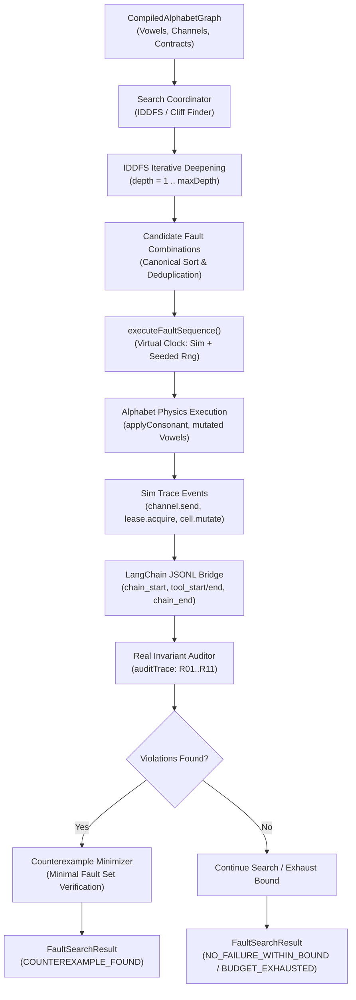
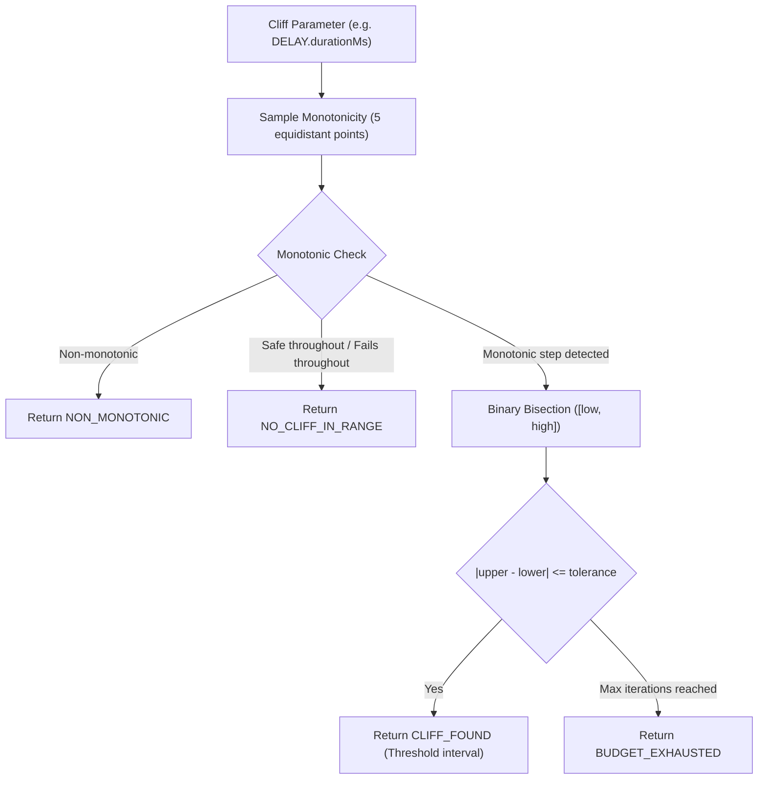

# Causal Alphabet Fault & Cliff Search Engine

The Causal Alphabet Search Engine systematically searches for multi-fault counterexamples and parameterized phase-change boundaries (cliffs) across causal alphabet system graphs.

It bridges the discrete 10-letter causal alphabet substrate (`CELL`, `LOG`, `LEASE`, `CHANNEL` + `DELAY`, `SEVER`, `DUPLICATE`, `SATURATE`, `WIPE`, `CORRUPT`) directly to the production invariant auditor (`resilient-agent-invariants`).

---

## 1. Architecture & Execution Graph

### Parameterized Cliff Search Architecture

---

## 2. Core Search Capabilities

### A. Iterative Deepening Depth-First Search (IDDFS)
- Traverses combinations of fault perturbations starting at depth 1, guaranteeing that any counterexample found has minimal fault depth $k$.
- Enforces strict exploration budgets (`maxEvaluations`, `maxDepth`).
- Employs canonical ordering and pruning of symmetric fault sequences.
- Completely deterministic under identical `seed` and configuration.

### B. Two-Fault Interaction Verification
- Evaluates non-linear systemic coupling where independent single faults pass safely, but concurrent/sequential pairs trigger severe contract collapse.
- Example: Network SEVER on retry with concurrent volatile cell WIPE causing idempotency cache loss and duplicate side effects (`r04-network-idempotency`).

### C. Parameterized Cliff Localization
- Evaluates continuous failure cliffs for numeric parameters (such as `durationMs` on channels or `loadUnits` on leases).
- Validates monotonicity across the search interval before bisection to prevent false convergence on non-monotonic degradation profiles.
- Employs binary bisection down to a user-specified tolerance (e.g., $\le 50\text{ ms}$).

---

## 3. Epistemic Boundaries: What the Engine Proves vs Does NOT Prove

### What the Engine PROVES:
1. **Minimum Fault Depth within Bound:** If a counterexample is discovered at depth $k$, no single fault or combination of size $< k$ violates the declared auditor invariants within the tested simulation configuration.
2. **Deterministic Replayability:** Every discovered counterexample produces the exact same audit finding, event sequence, and hash fingerprint when executed with the same seed.
3. **Bounded Safety:** If the search completes with `NO_FAILURE_WITHIN_BOUND` at depth $d$, no combination of up to $d$ candidate faults can trigger an invariant violation in the modeled alphabet graph under the exploration parameters.
4. **Localized Parameter Thresholds:** For monotonic degradation profiles, the phase transition boundary lies provably within the reported interval `[lowerSafeBound, upperFailureBound]`.

### What the Engine DOES NOT PROVE:
1. **Universal Safety / Production Correctness:** Passing within the simulator does not prove real-world distributed immunity; actual production systems may exhibit unmodeled behaviors, network nuances, or clock drifts.
2. **Safety Beyond the Search Bound:** A verdict of `NO_FAILURE_WITHIN_BOUND` at depth 2 provides no mathematical guarantee against vulnerabilities at depth $\ge 3$.
3. **Probabilistic Frequency:** The engine performs structural and combinatorial fault search, not Monte Carlo stress simulation. It indicates *can it fail*, not *how frequently will it fail in production*.
4. **Exhaustiveness Outside Modeled Alphabet:** Systemic vulnerabilities stemming from unmodeled components, third-party library internals, or non-alphabet semantics fall outside the proof boundary.

